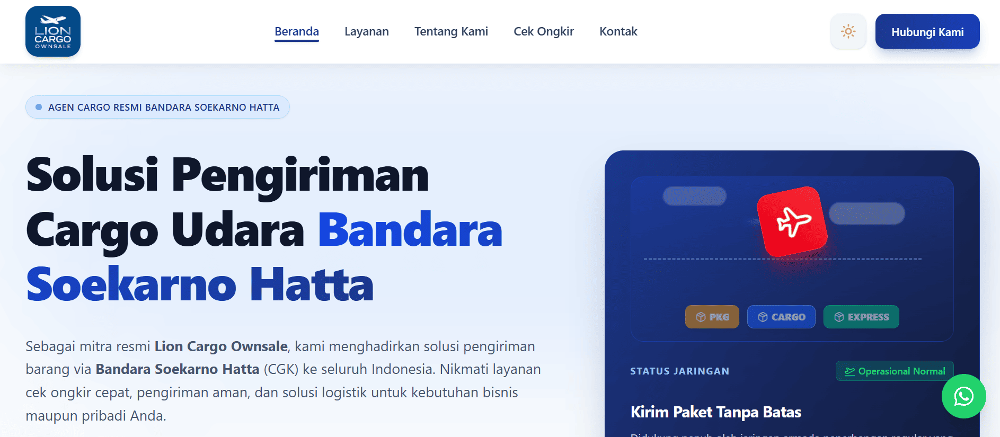
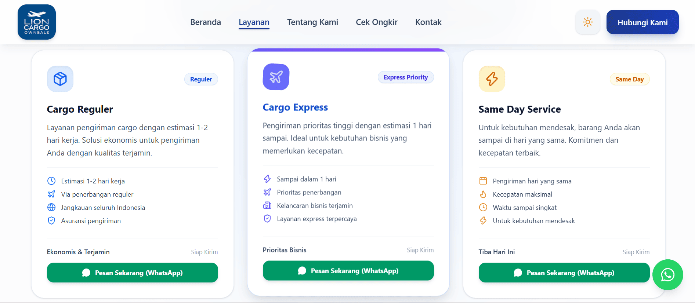
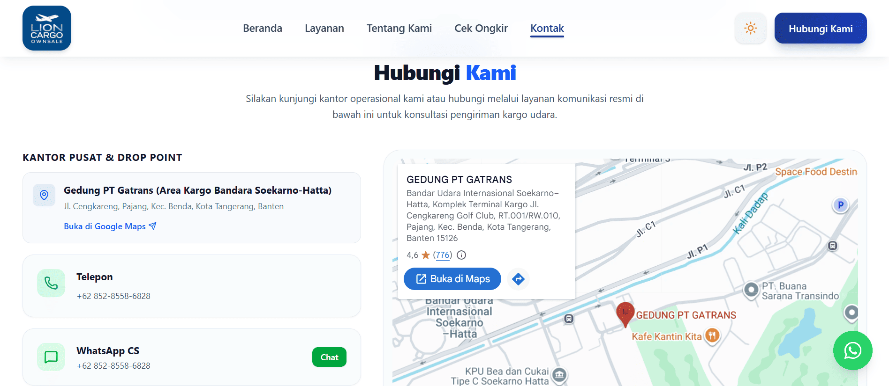

# ✈️ Lion Cargo Ownsale

An SEO-focused website for an air cargo service departing from Soekarno-Hatta Airport, with a shipping rate calculator and dedicated pages for 24 destination cities.

🌐 **Live website:** https://lioncargoownsale.com

## 📌 Overview

Lion Cargo Ownsale helps customers check air cargo rates from Jakarta to cities across Indonesia and contact the team directly through WhatsApp. The goal of the project is online visibility and customer accessibility: every page is prerendered to static HTML with its own metadata, so search engines and link previews get complete content without waiting for JavaScript.

- Single-page React app with prerendered static pages
- Tariff data managed in Google Sheets, no code change needed to update rates
- Deployed as static assets on Cloudflare Workers

## ✨ Features

### Website

- Landing page with services, about, features, airline partners, testimonials, FAQ, and contact sections
- Light and dark mode that follows the visitor's system preference and remembers their choice
- Responsive layout for mobile, tablet, and desktop
- WhatsApp and email contact links with prefilled messages
- Proper 404 page with a real 404 status for unknown URLs

### Shipping rate calculator

- `/cek-ongkir` page for checking cargo rates by destination
- Tariff data loaded from a published Google Sheet
- Data is validated before use, with built-in fallback data if the sheet cannot be loaded

### Destination pages

- 24 landing pages in the format `/cargo-udara-jakarta-<city>`
- Each page has its own title, description, and rate information
- Adding a new city takes one line in `src/config/destinations.js`

### SEO

- Pages prerendered to static HTML at build time
- Per-page metadata, Open Graph, and Twitter card tags
- JSON-LD structured data
- Generated `sitemap.xml` (26 URLs) and `robots.txt`

## ⚙️ How It Works

The build is more than a plain Vite build. `npm run build` runs three steps:

1. **Client build:** `vite build` bundles the React app.
2. **Server build:** `vite build --ssr src/entry-server.jsx` builds a version of the app that can render to HTML.
3. **Prerender:** `scripts/inject-meta.mjs` fetches the tariff data from Google Sheets, renders every route to a static HTML file with its own metadata, and generates `sitemap.xml` and `404.html`.

In the browser, the page starts with the tariff data embedded at build time, then refreshes it from Google Sheets so visitors always see the latest rates. If the sheet is unavailable, the app falls back to the data in `src/data/tarifData.js`, so the pages keep working.

## 🛠 Tech Stack

| Area         | Technologies                                |
| ------------ | ------------------------------------------- |
| Framework    | React 19, React Router 7                    |
| Build tool   | Vite 8 (client and server builds)           |
| Styling      | Tailwind CSS 4                              |
| Icons        | Lucide React                                |
| Data         | Google Sheets (published as CSV), PapaParse |
| Code quality | Oxlint                                      |
| Deployment   | Cloudflare Workers (static assets)          |

## 📂 Project Structure

```text
.
├── public          # Static files (logo, robots.txt)
├── scripts         # Build scripts (fetch tariffs, prerender pages, sitemap)
└── src
    ├── components  # UI sections (Hero, Services, FAQ, Footer, ...)
    ├── config      # Site info, routes, destinations, page metadata
    ├── data        # Built-in fallback tariff data
    ├── hooks       # Theme, tariff data, document metadata
    ├── pages       # Route pages (cek-ongkir, destination, 404)
    └── utils       # Tariff parsing and validation
```

## 📸 Screenshots

### Homepage



### Services



### Contact



## 🚀 Getting Started

### Prerequisites

- A current LTS version of Node.js
- npm

### Installation

```bash
git clone https://github.com/Bahrull-17/lion-cargo-ownsale.git
cd lion-cargo-ownsale
npm install
```

### Run the development server

```bash
npm run dev
```

Open the local URL shown in the terminal. No environment variables are needed. The tariff sheet URLs are defined in `src/config/tarifSource.js`.

## 📜 Available Scripts

| Command           | Description                                         |
| ----------------- | --------------------------------------------------- |
| `npm run dev`     | Start the development server                        |
| `npm run build`   | Build the app, then prerender all pages into `dist` |
| `npm run preview` | Preview the production build locally                |
| `npm run lint`    | Run Oxlint                                          |

## ☁️ Deployment

The site is deployed on Cloudflare Workers as static assets, configured in `wrangler.jsonc`:

- Build command: `npm run build`
- Assets directory: `dist`
- Unknown URLs are served the generated `404.html`

Tariff changes in Google Sheets appear in the browser right away. The prerendered HTML is refreshed on the next build.

## 👨‍💻 Developer

**Bahrul Ulum** · Full Stack Developer

🌐 Portfolio: https://bahrull-17.github.io/Portfolio/
💼 LinkedIn: https://www.linkedin.com/in/bahrul-ulum17
